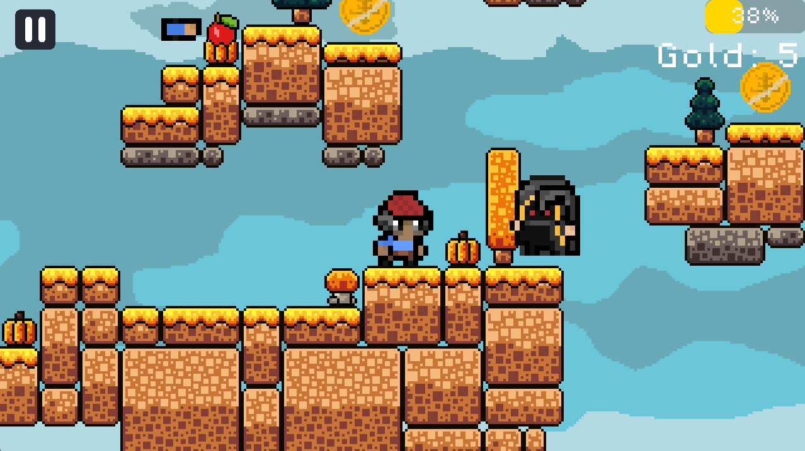
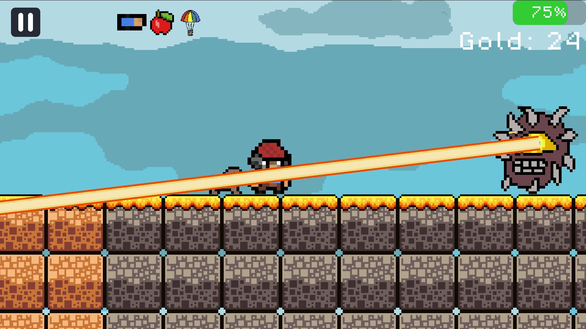
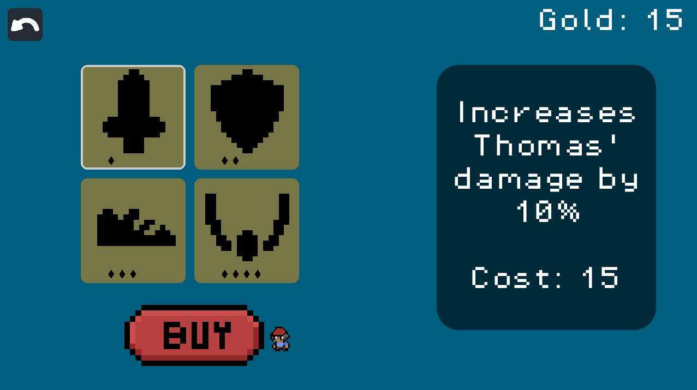
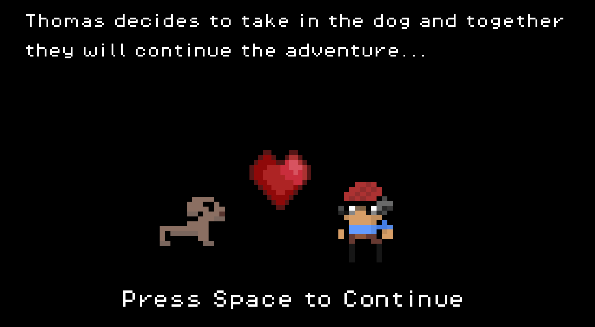
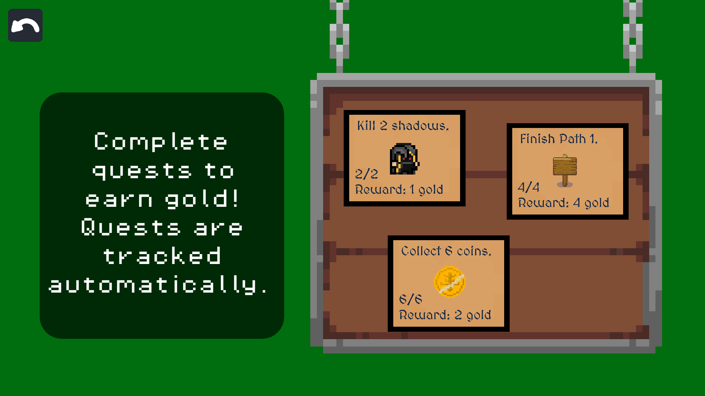
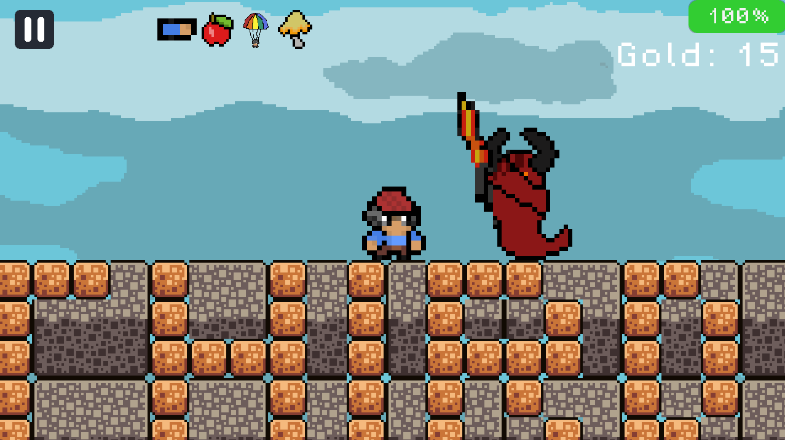
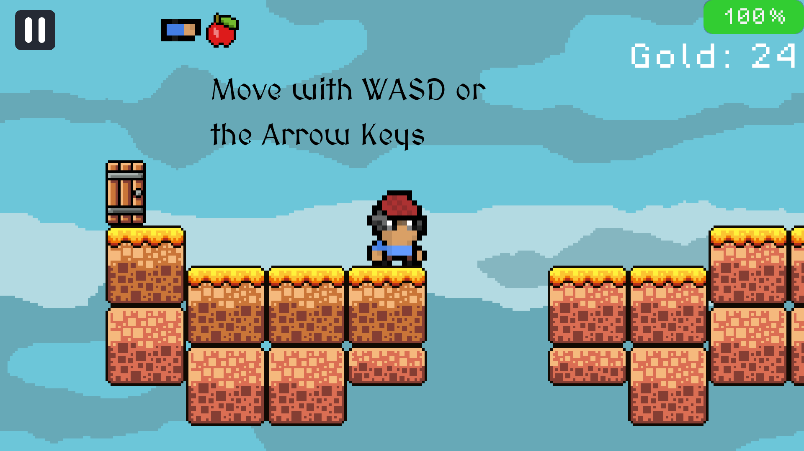
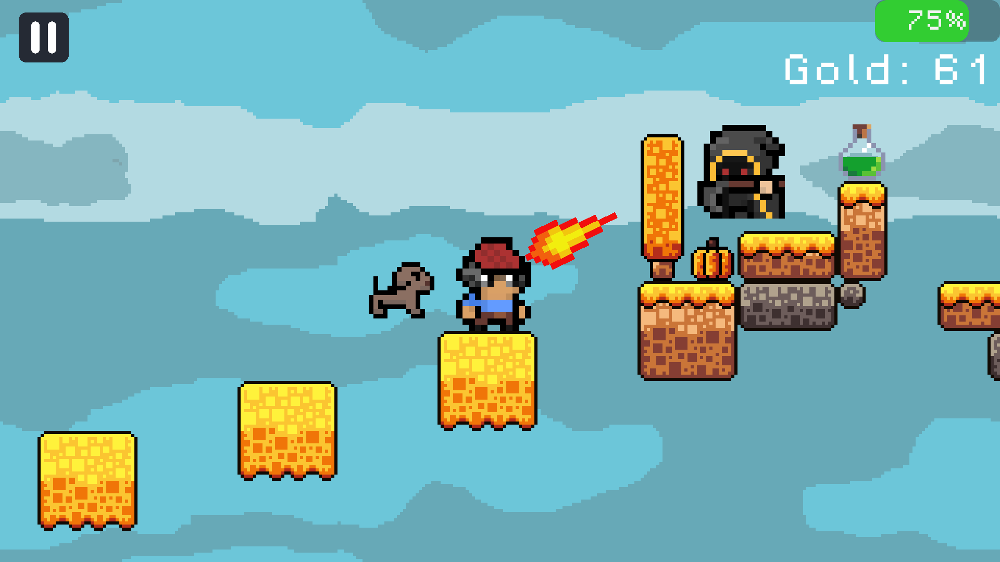
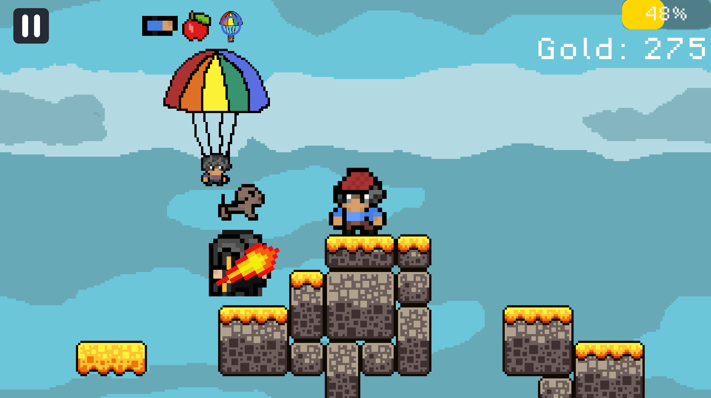
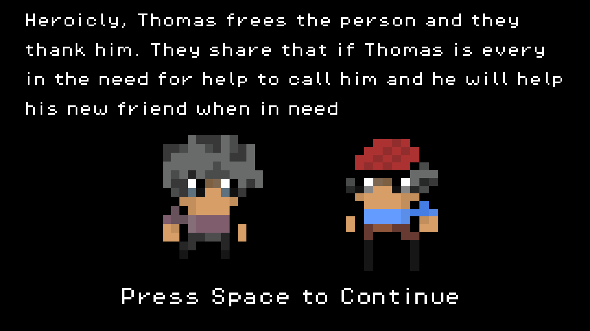

# Old-Thomas

<h2 align="center"> 
<a href="#play">Play</a>  
| <a href="#description">Desciption</a> 
| <a href="#game-structure">Game Structure</a> 
| <a href="#controls">Controls</a> 
| <a href="#new-features">New Features</a>
| <a href="#ai-usage">AI usage</a>
| <a href="#process-of-creating-this-game">Process</a>
| <a href="#photos">Photos</a>
 </h3>

## Play

You can play this game on itch.io: <a href="https://lillylike123.itch.io/old-thomas">link</a>

## Description

Join Thomas on an adventure as he conquers hurdles, one path at a time. Destroy monsters, collect coins and cinnamon, and help Thomas evolve as a person.
Old Thomas is a 2D platformer still in development where you join Thomas on an adventure of a lifetime.
Path 1 is centred around harvest and autumn time, when leaves change and the winter chill is drawing near.
Path 2 continues that harvest and autumn feel, plus special treasure chests hidden in the levels, plus you get a cute lil dog :)!

Path 3 takes it to the next level as the game gets a little bit harder for Thomas (still tying into the autumn theme of course!). And you can't forget the new friend you meet along the way!
<<<<<<< Updated upstream
Path 4 keeps the nice autumn theme but also IS HARDER!!!
Plus, more paths and features are always coming out, so make sure to keep playing every week!!!
=======
Path 4 keeps the nice autumn theme but also IS WAY HARDER!!! 
Unfortuantly for now the game is wrapped up!!! But hopefully in the future it can get imporved!
>>>>>>> Stashed changes
Additionally, there is also a shop where you can buy upgrades to level up Thomas and a town where you can complete quests and get AWESOME rewards!

And you can't forget about the excellent music; it really helps set the mood!!! (it's advenutre and zelda themed hehe)
Don't worry there is a tutorial at the start to guide you through the basics of the game!

_Seasonal Event_
New cinnamon collectable! Collect cinnamon on your journeys and get 3x more coins each. (Who doesn't like cinnamon??? ESPECIALLY IN FALLL!!! hehehe...)

I hope you enjoy this adventure. Good luck! (Yippppee!)

## Game Structure

This game is structured very uniquely! You follow Thomas as you finish paths one by one.
Each path has four levels, with 4 paths being available currently.
On top of that you are also able to go to the shop and buy upgrades!
Visit the town to complete quests and earn rewards!
Can't forget to occasionally visit home to meet the friends you met along the way as well as collectables!!!
At the end of paths you must defeat a diffucult boss! You may want to gear up in the shop and complete quests before these milestones!!!

## Controls

Jump: Space or W or Up Arrow

Basic attack: J or Right Mouse Button

Ranged attack: K or Left Mouse Button

Friend ability: 1

Weird mushroom ability: 2

Skip cutscene: S

## New Features

<<<<<<< Updated upstream
YAY! New featureeess!
There is now a new boss with its own attack system (hooray!)
There is a tutorial level at the start so the user can understand how to play the game!
You can now use Thomas as a cursor and really feel like you exploring the world of the game using WASD and Enter!
There are some new sprites for Thomas that unfortunatly have no been implemented due to time difficulties :(, but they will be implemented next week!
There are two new cutscenes: one for when you gaina doggy comapinion and one for when you make a friend along your journey!
Hope you enjoy these features along with the slightly more polished levels!

=======
HOORAY NEW FEATURESSSS!
Firstly there is now a boss for path 4 that you need to defeat to finish the path!
There is also level hardcore where you need to fight ALL 4 bosses at the same time!!!
There is also a credits scene in the start page.
You can't forget the new mushroom ability that you can use!
Additonally, there is 2 new cutscenes one for gaining the mushroom ability and one for finally finishing the level!
Hope you enjoy the new features and the awesome game!
>>>>>>> Stashed changes

## AI Usage

AI was used in this project for

- debugging the code for the ghost (but has now been updated by a human)
- debugging code for the cutscene in Godot (as this is the first time I have ever made a cutscene and woah that was hard a first lol)
- understanding the debugger (some of the stuff were so hard to understand for my lil brain _sob_)
- fixing the git commits (asked what was needed to fix the mess)

## Process of Creating this Game

This game is made by Amira and Jimi for Thirdspace!

We had to go through many challanges and well as victories through the process of creating this game that you will/are have played!
The big main problem is that we practically live opposite each other location-wise, with a different time zone, which really gets messed up with school and sleep time.
To put this in perspective, when Jimi is working, Amira is at school and while Amira is working, Jimi is sleeping!

This created a problem with communication because if we couldn't continue or submit properly and are not able to ask the other teammate to help, it was super hard!!!
To solve this, we made sure to share what we will do beforehand and what we have after!
Together, we have worked so hard to create a game for others to enjoy!

\*Also note for week 5! I had to revert some commits due to conflicts and redo some level changes ALL OVER AGAIN. but it should how in the git history!

\*Also week 7 there were some commit issues and some work needed to be discarded in order to carry over important work and so the came doesn't get completely distroyed hehe...

<3 <3 <3

## Photos

